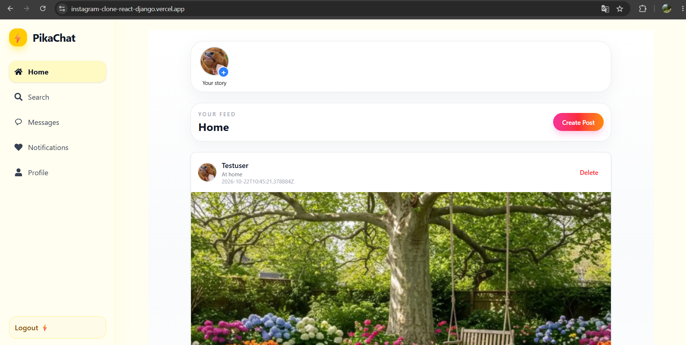
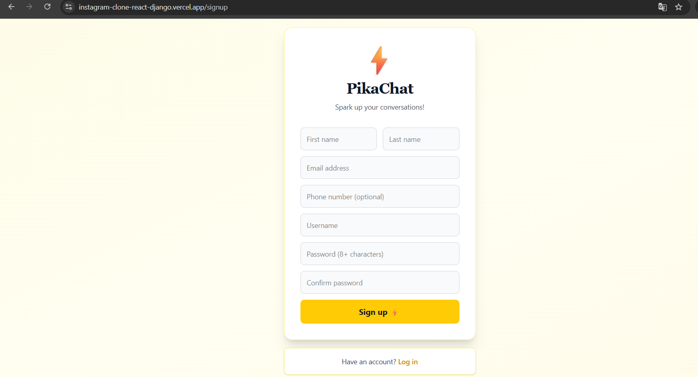
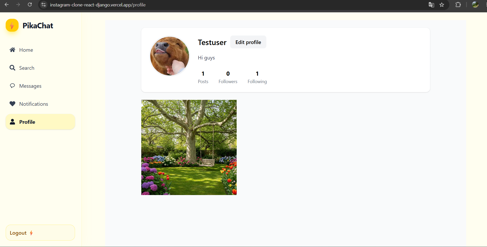
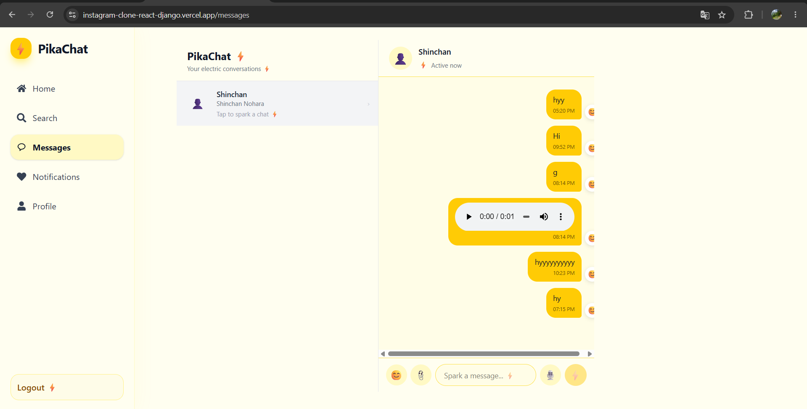
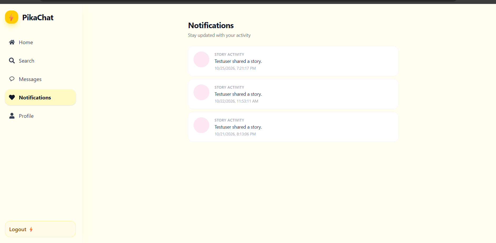

# ⚡ PikaChat — A Full-Stack Instagram Clone (React + Django)

A fully functional, Instagram-inspired social media application built using React and Django REST Framework, featuring a custom "PikaChat" yellow theme. 

The project includes secure authentication, dynamic feeds, real-time chat with a hybrid messaging system, stories, follow systems, and real-time notifications.

---

## ✨ Features

### 🔐 Authentication
- User Login & Signup
- Protected Routes
- JWT Authentication
- Password Reset & Email Verification
- Google OAuth Authentication

### 🏠 Social Feed
- Dynamic Instagram-style feed
- Create image posts with captions and locations
- Like and comment on posts
- Delete own posts

###  User Profiles
- Profile picture and Bio
- Followers & Following count
- Follow / Unfollow functionality
- Private account support with follow requests

### 📖 Stories
- Create image/video stories
- Instagram-style "My Story" viewer
- Story reactions and replies
- Automatic story expiration

### 💬 Real-Time Chat (PikaChat Theme)
- User-to-user messaging
- Real-time messages using WebSockets (with HTTP fallback for reliability)
- Typing indicators ("Charging up a message... ")
- Message reactions and emojis
- Image, video, and voice note attachments
- Custom "Pop-in" bubble animations

###  Notifications
- Real-time notifications for likes, comments, follows, and messages
- Unread message counters

### 🔍 Search
- Search users by username
- User profile preview

---

## ️ Tech Stack

### Frontend
- React.js + Vite
- Tailwind CSS (Custom PikaChat Theme)
- JavaScript (ES6+)

### Backend
- Python + Django
- Django REST Framework (DRF)
- Django Channels (WebSockets)

### Database & Storage
- PostgreSQL (via Supabase)
- Cloudinary (for media/image storage)

### Deployment & DevOps
- **Frontend:** Vercel
- **Backend:** Render (ASGI via Daphne)
- Git & GitHub

---

## 🚧 Challenges & Solutions

**Challenge:** Implementing real-time WebSockets on free-tier hosting (Render). Free-tier servers sleep after inactivity, causing WebSocket connections to drop (Error 1006) and messages to fail.

**Solution:** 
- Configured the backend to use an ASGI server (Daphne) for WebSocket support.
- Implemented a **Hybrid Messaging System**: Used WebSockets for the real-time "typing" and "live" feel, but added an **HTTP POST fallback** for sending actual messages. This ensures 100% message delivery reliability even if the WebSocket temporarily disconnects.
- Added automatic reconnection logic on the frontend.

**Learning:** Understanding the trade-offs between free-tier infrastructure limitations and production-grade reliability, and how to engineer around them.

---

##  Screenshots

### 🏠 Home Feed


### SignUp functionality


### 👤 Profile


### 💬 PikaChat Real-Time Messaging


### 📖 Stories


### 🔔 Notifications


---

##  What I Learned

While building PikaChat, I learned:
- How to architect and build a complete full-stack application from scratch.
- How to seamlessly integrate React with a Django REST API.
- Implementing JWT-based authentication and secure protected routes.
- Managing complex state and props in React.
- Designing and implementing real-time features using Django Channels and WebSockets.
- **Crucial:** How to handle deployment constraints and build fallback mechanisms for free-tier hosting.
- Customizing UI/UX with Tailwind CSS to create a unique brand identity (PikaChat).
- Professional Git and GitHub workflow for version control.

---

## 📁 Project Structure

```text
instagram-clone-react-django/
│
├── backend/
│   └── hlo/
│       ├── accounts/
│       ├── follows/
│       ├── posts/
│       ├── stories/
│       ├── messages/
│       ├── notifications/
│       └── hlo/
│
├── frontend/
│   ├── public/
│   └── src/
│       ├── components/
│       ├── pages/
│       ├── utils/
│       ── App.jsx
│
├── screenshots/
│   ├── home.png
│   ├── profile.png
│   ├── stories.png
│   ├── chat.png
│   └── notifications.png
│
├── .gitignore
└── README.md

🚀 How to Run Locally
Backend:-
cd backend/hlo
Create a virtual environment: python -m venv venv
Activate it and install dependencies: pip install -r requirements.txt
Run migrations: python manage.py migrate
Start the server: python manage.py runserver

Frontend:-
cd frontend
Install dependencies: npm install
Start the development server: npm run dev

Made with ⚡ and ☕ by [DIVYA JYOTI]